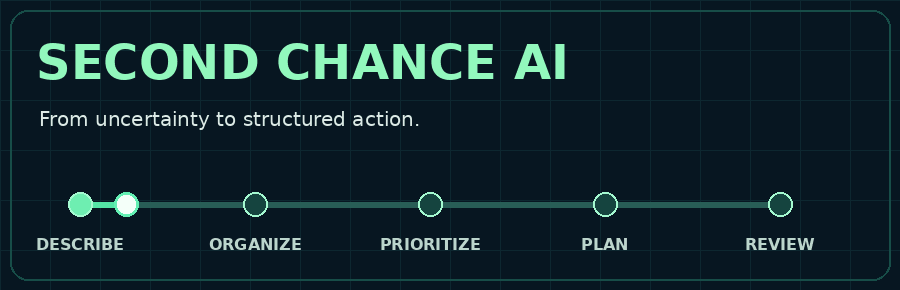

<div align="center">



<br/>

# Second Chance AI
### A practical planning concept for life's difficult transitions

**Gemma 4 research concept · Human-centered design · Privacy-aware approach**

[](https://dr-ahmed-abdelsalam.github.io/second-chance-ai-demo/)
[](https://www.kaggle.com/code/drahmedmabdelsalam33/second-chance-ai-a-gemma-4-orchestrated-recovery)
[](https://youtu.be/MpZMCsMGmC8)

<br/>


**A clear next step can make a complex situation easier to navigate.**

</div>

---

## 01 / The vision

A job transition, overdue obligations, or a disrupted routine rarely arrives as a neatly defined problem. People are often dealing with **several connected decisions at once**.

**Second Chance AI** explores a human-centered planning experience: describe a challenge in everyday language, organize the relevant priorities, and develop a sequence of small, practical actions.

The aim is **decision support, not automated decision-making**. It is an exploratory project, not an intervention service or a validated assessment tool.

<table>
<tr><td width="33%" align="center"><b>UNDERSTAND</b><br/><sub>Turn a complex description into an organized view</sub></td><td width="33%" align="center"><b>PRIORITIZE</b><br/><sub>Distinguish immediate needs from later goals</sub></td><td width="33%" align="center"><b>MOVE FORWARD</b><br/><sub>Translate priorities into manageable actions</sub></td></tr>
</table>

## 02 / The experience


| Planning horizon | Intended outcome |
|---|---|
| **First 24 hours** | A short, practical list of immediate actions |
| **Next 7 days** | A manageable sequence of daily priorities |
| **Next 30 days** | A direction for rebuilding routines and tracking progress |

> This is the **proposed product journey**, not a claim that the static website performs AI reasoning.

## 03 / Live demonstration

The public GitHub Pages site is a **lightweight interactive prototype** for exploring the proposed user interface.

| What you can try | What actually happens |
|---|---|
| Describe a situation | Text is used to trigger the demo flow |
| Enter Arabic or English | Basic Arabic-character detection selects a language-specific example |
| Add an image | The selected image is **previewed locally** |
| Request a plan | A **prewritten illustrative response** is displayed |

**Important:** The web demo **does not run Gemma 4**, interpret uploaded images, produce individualized assessments, or calculate validated risk scores. The separate Kaggle notebook is linked as a research implementation resource; it has not been independently evaluated in this repository.

<div align="center">

### [↗ Launch the interactive demonstration](https://dr-ahmed-abdelsalam.github.io/second-chance-ai-demo/)

</div>

## 04 / Technical overview

**Current browser demo**

```text
index.html
   ├── Responsive interface (HTML + CSS)
   ├── Text entry and optional image preview
   ├── Basic Arabic / English detection
   └── Static demonstration outputs (JavaScript)
```

**Research concept**

```text
Context intake → Structured analysis → Prioritization
             → AI-assisted planning → Human review
```

The research concept and the functioning browser demo are deliberately presented separately so that visitors can distinguish **implemented features from future or external components**.

### Run locally

```bash
git clone https://github.com/Dr-Ahmed-Abdelsalam/second-chance-ai-demo.git
cd second-chance-ai-demo
```

Open `index.html` in a modern browser. **No API key or model installation is needed for this static demo.**

## 05 / Design commitments

| Principle | Why it matters |
|---|---|
| **Human agency** | Users remain responsible for their choices |
| **Explainability** | Priorities and suggested actions should be understandable |
| **Privacy awareness** | Sensitive information requires careful handling |
| **Accessibility** | Interfaces should work across languages and devices |
| **Evidence before claims** | Numerical scores and planning quality require validation |

The current browser code makes **no external AI API requests** and previews selected images locally. However, the fact that a browser demo works without an AI API does **not** establish complete privacy for all hosting environments or future versions. Please do not enter confidential or sensitive personal data in experimental demonstrations.

## 06 / Research roadmap

- [ ] Evaluate whether generated plans are **useful, safe, and actionable**.
- [ ] Investigate **local inference** and practical hardware requirements.
- [ ] Improve **Arabic-language understanding** beyond character detection.
- [ ] Develop **transparent, evaluated prioritization criteria**.
- [ ] Explore **user-controlled progress tracking**.
- [ ] Document limitations, reproducibility, and appropriate safeguards.

*These are proposed research directions, not completed or guaranteed features.*

## 07 / Limitations & responsible use

Second Chance AI is an **experimental research and interface demonstration**. It does not provide medical, psychological, legal, financial, or emergency services. Its illustrated classifications, urgency labels, and numerical scores are **not validated assessments**. Do not use demonstration outputs to make high-stakes decisions. Real-world deployment would require careful evaluation, domain review, and suitable protective measures.

---

## Explore the project

| | |
|---|---|
| **Interactive demo** | [Open GitHub Pages ↗](https://dr-ahmed-abdelsalam.github.io/second-chance-ai-demo/) |
| **Gemma 4 research notebook** | [Explore on Kaggle ↗](https://www.kaggle.com/code/drahmedmabdelsalam33/second-chance-ai-a-gemma-4-orchestrated-recovery) |
| **Video walkthrough** | [Watch on YouTube ↗](https://youtu.be/MpZMCsMGmC8) |
| **Repository source** | [Browse code ↗](https://github.com/Dr-Ahmed-Abdelsalam/second-chance-ai-demo) |

<div align="center">

---

**Created by [Ahmed M. Abdelsalam, PhD](https://github.com/Dr-Ahmed-Abdelsalam)**

<sub>PhD in Law · MSc IT Researcher · Legal AI, NLP & Data Science · International Arbitration</sub>

<br/><br/>

**SECOND CHANCE AI**

<sub>Human-centered thinking. Responsible technology. Practical next steps.</sub>

</div>
